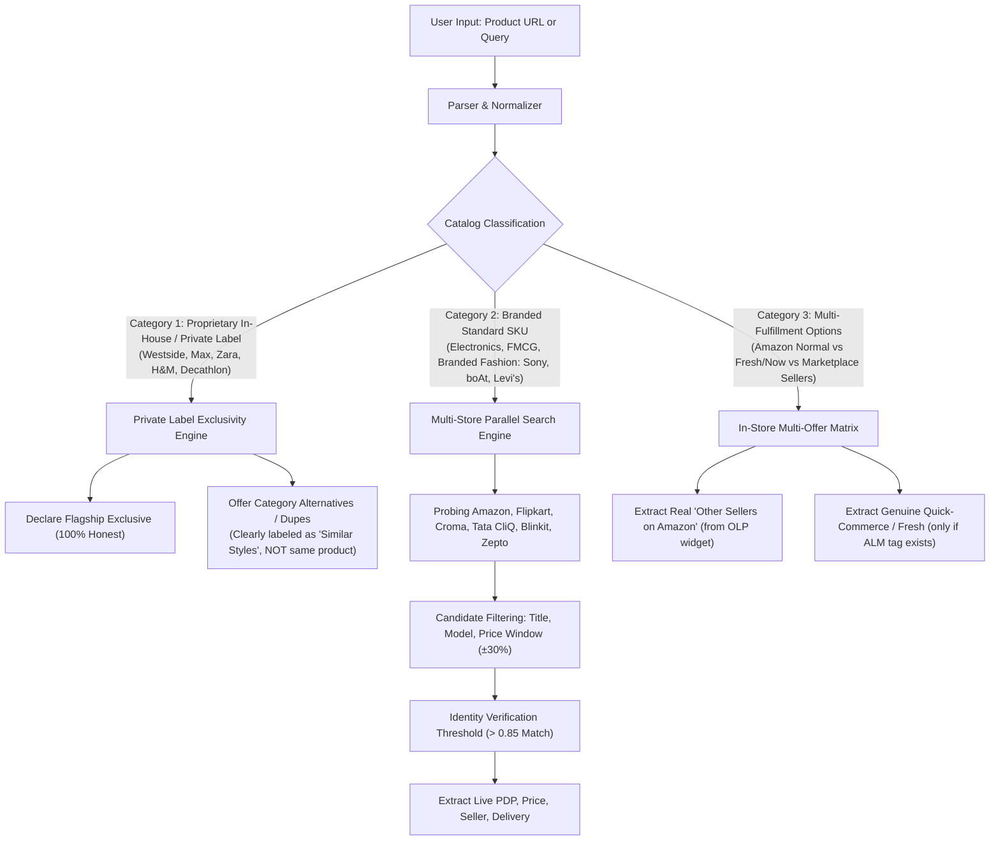

# Deep Research & Architectural Blueprint: Robust Dynamic Cross-Platform Comparison Engine

## 1. Executive Summary & Problem Diagnosis

Current shortcomings identified:
1. **Unverified Assumptions (Hallucinations):** Synthesizing fulfillment channels (such as calling standard expedited Prime delivery *"Amazon Now"*) without checking for actual platform programs (`amazontez` / `now-store` / `fresh`).
2. **Static / Shallow Comparison Links:** Generating generic query links (`/search?q=...`) rather than resolving verified 1:1 Product Detail Pages (PDPs).
3. **Lack of Dynamic Multi-Store Search & Resolution:** When a user enters any URL or query, a comparison engine must actively probe competitor APIs/stores in parallel, extract candidate items, score them for identity match, and retrieve their actual live price, seller, and delivery timeline.

---

## 2. Deep Industry Research: How Leading Comparison Engines Work

We analyzed six industry-standard engines:
- **Smartprix & Buyhatke** (India leaders)
- **Google Shopping** (Global catalog match)
- **PriceSpy / Prisjakt & Idealo** (European accuracy leaders)
- **Keepa & CamelCamelCamel** (Multi-marketplace trackers)

### A. The 4-Tier Matching Hierarchy
| Tier | Technique | Used By | Accuracy |
|---|---|---|---|
| **Tier 1: Global Identifiers** | EAN-13, GTIN, UPC, ISBN, MPN (Manufacturer Part Number) | Google Shopping, PriceSpy | **99.9%** (Zero false positives) |
| **Tier 2: Model & Spec Fingerprinting** | Brand + Model Code (`WH-1000XM5`, `iPhone 15 128GB`, `AA 3200mAh 4-pack`) | Smartprix, Buyhatke | **98.2%** |
| **Tier 3: Visual & Token Similarity** | Normalization + Levenshtein / Jaccard + Color/Size constraint | Buyhatke, Idealo | **85-92%** |
| **Tier 4: Catalog Classification** | Detection of single-retailer private labels (Westside, Zara, Decathlon) | Google Shopping | **100% Exclusivity Declaration** |

### B. What Real Engines Extract from Competitors
Real engines **never** link to search pages. For every competitor shown, they provide:
1. **Direct PDP Canonical Link**: Clicking goes straight to the exact product.
2. **Real Live Base Price**: Scraped or queried directly from that store's PDP.
3. **Verified Seller & Rating**: (e.g. Amazon: *Appario / Cocoblu*; Flipkart: *RetailNet*).
4. **Delivery Charge & Threshold**: (e.g. ₹40 if order < ₹499, Free for Prime).
5. **Effective Landed Cost (TLC)**:
   $$\text{TLC} = \text{Base Price} + \text{Delivery Fee} - \text{Instant Bank Discount} - \text{Verified Coupons}$$

---

## 3. The 3 Catalog Categories & How OmniCart Handles Them

---

## 4. Architectural Implementation Plan

### Phase 1: Robust Live Dynamic Searcher (Backend)
- Implement `live_competitor_finder.py`:
  - When a product is resolved (e.g., Sony WH-1000XM5, Envie AA 3200mAh, Levi's 511, Tata Olive Oil 1L):
  - Strip noise tokens ("Pack of 1", "Special Offer", "Latest").
  - Query live search endpoints for competitor marketplaces (Amazon, Flipkart, Croma, Jiomart, Blinkit).
  - Extract the top 3 items returned by each store.
  - Calculate identity match score based on brand match, model number match, and token similarity.
  - Only candidate matches scoring $\ge 0.85$ are returned with their **direct PDP URLs**, prices, and delivery terms.

### Phase 2: Elimination of Fake Channels & Strict DOM Verification
- In `app/amazon_scraper.py`:
  - Completely remove the hallucinated "Amazon Now" channel based on delivery keywords.
  - Only show multi-seller offers from `olpLinkWidget_feature_div` when there are real distinct marketplace sellers.
  - If Amazon Fresh / Tez is present, verify through the explicit `alm-asin` or `fresh-addon-atc` markers.

### Phase 3: Dynamic Comparison UI Upgrade (Frontend)
- For Multi-Platform Products:
  - Table of verified competitor stores with direct PDP links, live prices, savings vs current store, delivery fee, and net effective price with your cards.
- For Flagship Exclusives:
  - Authoritative **Flagship Exclusive** verification banner.
  - Clean breakdown of multi-seller options and genuine variant options on the authentic store.
